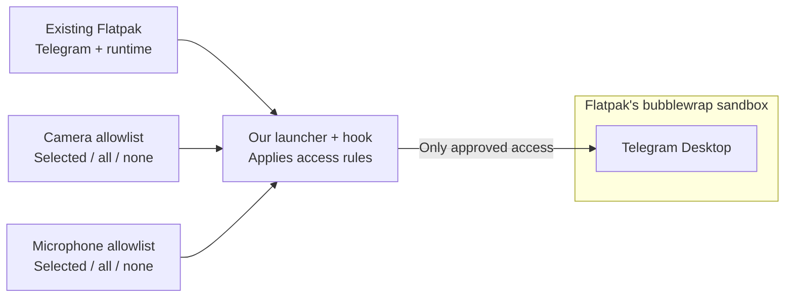

# Telegram Flatpak Secure

Telegram Desktop from Flathub, with configurable camera and microphone access.

## How it works



The launcher customizes **Flatpak's own sandbox at each launch**, using permission overrides and a bubblewrap hook. It removes broad filesystem, device and host-service access, then adds the approved camera devices and audio socket. Linux namespaces and bind mounts control what Telegram can see and access. The configured profile, Telegram downloads, network, GPU and desktop display remain available; microphone blocking keeps sound playback available.

## Setup

Open a terminal in your X11 or Wayland desktop session on Debian and run:

```bash
./telegram-setup.bash
```

Setup installs or updates Telegram and asks which cameras and microphones it may use. It shows the current selections and available devices. Choose device numbers, `all`, or `none` for each; press Enter to keep the current choice. Disconnected selections remain available to keep or remove.

Launch **Telegram** from the application menu afterward. Setup routes the menu entry, `tg:` links and existing Telegram autostart entries through the wrapper. It asks before replacing an existing launcher.

The same launcher uses Wayland when available and falls back to X11 automatically. X11 shares display access between applications; Wayland provides stronger display isolation.

Telegram can update through its own updater or your desktop's Flatpak update tools, including automatic updates when enabled. Rerunning setup is optional for Telegram updates.

Run `./telegram-setup.bash` again to change camera/microphone access, choose an existing Telegram profile, check and repair the setup, or remove the wrapper. Setup also refreshes the private audio broker when used on a PipeWire desktop. Repeated setup keeps the current choices unless you change them. Profiles and downloads are retained.

Microphone blocking keeps sound playback available. Camera and microphone access can each be limited to selected devices, allowed for all, or blocked entirely. Microphones are matched by desktop audio input names; a sound card's input ports may share one such input.

Restart Telegram after connecting a selected camera or microphone that was absent when it started. A missing selected microphone does not grant access to another input. Launch errors are recorded in `$XDG_RUNTIME_DIR/telegram-sandbox.log` when started from setup; use **Check / repair** to diagnose sandbox and launch configuration.

[MIT license](LICENSE)
