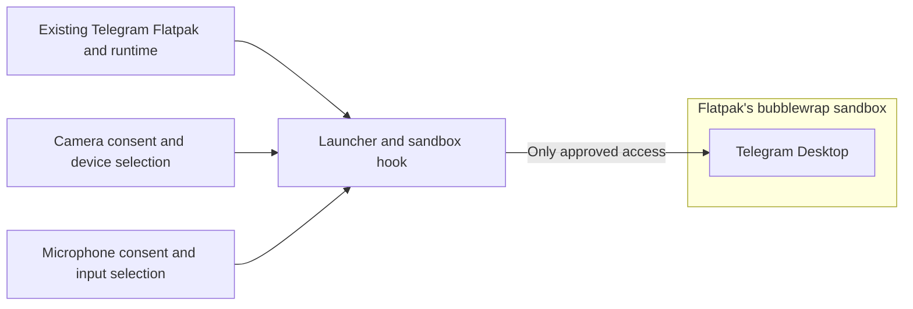

# Telegram Flatpak Secure

Telegram Desktop from Flathub, with native desktop consent and configurable camera and microphone access.

## How it works



The launcher customizes **Flatpak's own sandbox at each launch**, using permission overrides and a bubblewrap hook. It removes broad filesystem, device and host-service access, then adds approved camera devices and a private audio socket. The configured profile, Telegram downloads, network, GPU and desktop display remain available. Blocking the microphone keeps sound playback available.

Native microphone and camera permissions are required before the corresponding devices become available. Missing permissions start disabled; only an explicit `yes` grants access. A guardian watches the native permission store and GNOME's global privacy switches. Changing effective consent, losing the permission service or losing its monitor closes the running Telegram session. Relaunch Telegram to apply the new choice.

Every microphone mode uses a separate PipeWire server and WirePlumber policy process. Telegram receives only that server's Pulse-compatible socket. Approved input sources and one playback sink are connected through fixed tunnels; the host audio socket, host playback monitors and private control socket remain outside the sandbox. Denied microphone consent blocks recording, including the private playback monitor. The broker cannot substitute another microphone when a selected one disappears.

The D-Bus proxy keeps the desktop and document portals available while blocking permission-store writes, dconf writes and Flatpak subprocess spawning that would leave consent supervision.

## Setup

Open a terminal in your X11 or Wayland desktop session on Debian and run:

```bash
./telegram-setup.bash
```

Setup installs or updates Telegram and asks which cameras and microphones to include in the saved device selection. Choose device numbers, `all`, or `none` for each; press Enter to keep the current choice. Disconnected selections remain available to keep or remove. Existing native permission choices are preserved.

On GNOME, use **Settings → Apps → Telegram** to grant or revoke microphone and camera consent. These are persistent application permissions. The equivalent native commands are:

```bash
flatpak permission-set devices microphone org.telegram.desktop yes
flatpak permission-set devices camera org.telegram.desktop yes
```

Use `no` to revoke either permission. Missing, `ask` and unrecognized values are denied. There is no separate permission prompt for every call.

Launch **Telegram** from the application menu afterward. Setup routes the menu entry, `tg:` links and existing Telegram autostart entries through the wrapper. It asks before replacing an existing launcher.

The same launcher uses Wayland when available and falls back to X11 automatically. X11 shares display access between applications; Wayland provides stronger display isolation.

Telegram can update through your desktop's Flatpak update tools, including automatic updates when enabled. Rerunning setup is optional for Telegram updates. Features that require the Flatpak subprocess portal may be unavailable because that route is blocked.

Run `./telegram-setup.bash` again to change device selections, choose an existing Telegram profile, check and repair the setup, or remove the wrapper. The private audio broker uses Debian's PipeWire and WirePlumber packages. Repeated setup keeps the current choices unless you change them. Profiles and downloads are retained.

Microphone selections further restrict a native microphone grant to selected inputs, all inputs or none. Inputs are matched by desktop audio source names; a sound card's input ports may share one such source.

Camera selections restrict direct V4L device access. **Native Camera consent is application-wide:** when enabled, the Camera portal can provide other cameras too. Use the native Camera switch to block all camera access, including that portal. A saved camera selection of `none` only removes direct device mounts.

Restart Telegram after connecting or reconnecting a selected camera, microphone or playback device. A missing selected microphone does not grant access to another input. The broker requires a local filesystem audio socket and the standard session bus at `$XDG_RUNTIME_DIR/bus`. Separately configured network audio services are outside this filesystem isolation boundary.

Launch errors are recorded in `$XDG_RUNTIME_DIR/telegram-sandbox.log` when started from setup; use **Check / repair** to diagnose sandbox and launch configuration.

## Validation

The configuration, setup, desktop-routing, native-consent argument and unavailable-permission-store regression checks pass. Bash syntax and ShellCheck checks at error severity pass. The private audio configuration and consent supervisor were also checked during development.

**Full audio, D-Bus revocation and desktop integration remain unverified in the development environment:** it rejects Unix socket creation with `EPERM`. The audio/display integration tests require a separate desktop or worker with private synthetic audio and permission-store fixtures. The checks above do not establish that calls or webcams work on a real desktop.

[MIT license](LICENSE)
